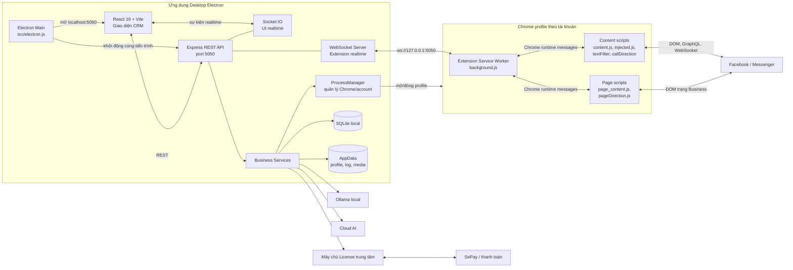
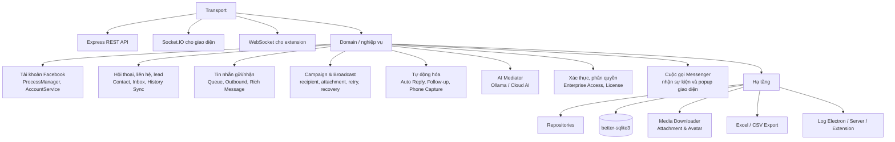
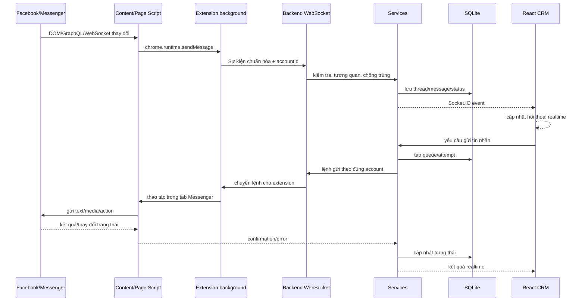
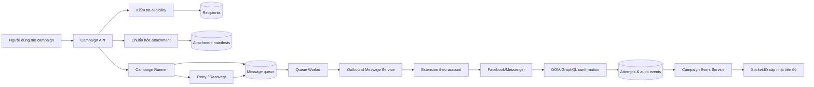
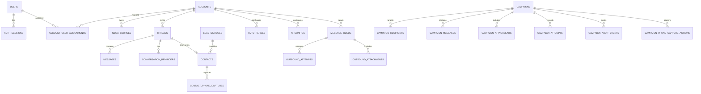

# Sơ đồ kiến trúc hiện tại — FB Personal Messenger CRM

> Trạng thái **as-is**, đối chiếu trực tiếp từ mã nguồn ngày 06/09/2026.

## 1. Kiến trúc tổng thể



## 2. Các khối chức năng đang có



## 3. Luồng tin nhắn realtime



## 4. Luồng chiến dịch gửi hàng loạt



## 5. Mô hình dữ liệu mức cao



Các bảng chính hiện có: `users`, `auth_sessions`, `account_user_assignments`, `accounts`, `removed_accounts`, `inbox_sources`, `threads`, `conversation_reminders`, `messages`, `lead_statuses`, `phone_capture_automation_settings`, `contacts`, `contact_phone_captures`, `auto_replies`, `ai_configs`, `message_queue`, `outbound_attachments`, `outbound_attempts`, `campaigns`, `campaign_recipients`, `campaign_messages`, `campaign_attachment_manifests`, `campaign_attachments`, `campaign_attempts`, `campaign_audit_events`, `campaign_phone_capture_actions`.

## 6. Cấu trúc mã nguồn

```text
crm_fb/
├─ src/
│  ├─ electron.js                 # tiến trình chính Electron
│  ├─ preload.js                  # cầu nối an toàn Electron ↔ renderer
│  ├─ main.jsx, App.jsx           # ứng dụng React
│  ├─ components/                 # giao diện CRM
│  ├─ services/                   # client API/realtime phía UI
│  ├─ server/
│  │  ├─ server.js                # Express + Socket.IO + WebSocket
│  │  ├─ routes/                  # các REST endpoint
│  │  ├─ services/                # nghiệp vụ hệ thống
│  │  ├─ repositories/            # truy cập dữ liệu
│  │  ├─ database/                # schema + migration SQLite
│  │  └─ utils/                   # tiện ích backend
│  └─ extension/
│     ├─ manifest.json            # Chrome Extension MV3
│     ├─ background.js            # service worker + kết nối backend
│     ├─ content.js               # thao tác Messenger cá nhân
│     ├─ injected.js              # hook ngữ cảnh trang
│     ├─ page_content.js          # Messenger/Page/Business
│     └─ *Direction.js            # xác định chiều sự kiện/tin nhắn/cuộc gọi
├─ license_server/                # server license & thanh toán tách biệt
├─ tests/                         # unit/integration tests
├─ specs/                         # tài liệu đặc tả theo feature
├─ scripts/                       # build, migration, kiểm tra
├─ docs/                          # tài liệu dự án
└─ release/                       # bộ cài và bản win-unpacked
```

## 7. Ranh giới triển khai

- **Máy người dùng:** Electron, React UI, Express local, Socket.IO, WebSocket, SQLite, Chrome profiles và extension.
- **Hệ thống bên ngoài:** Facebook/Messenger, máy chủ license, SePay, Ollama hoặc Cloud AI.
- **Dữ liệu cục bộ:** tài khoản cấu hình, hội thoại, tin nhắn, chiến dịch, hàng đợi, trạng thái gửi, contact/lead, log và media.
- **Điểm kết nối quan trọng:** UI ↔ backend bằng REST/Socket.IO; extension ↔ backend bằng local WebSocket; extension ↔ Facebook bằng DOM/GraphQL/WebSocket trong trình duyệt.

