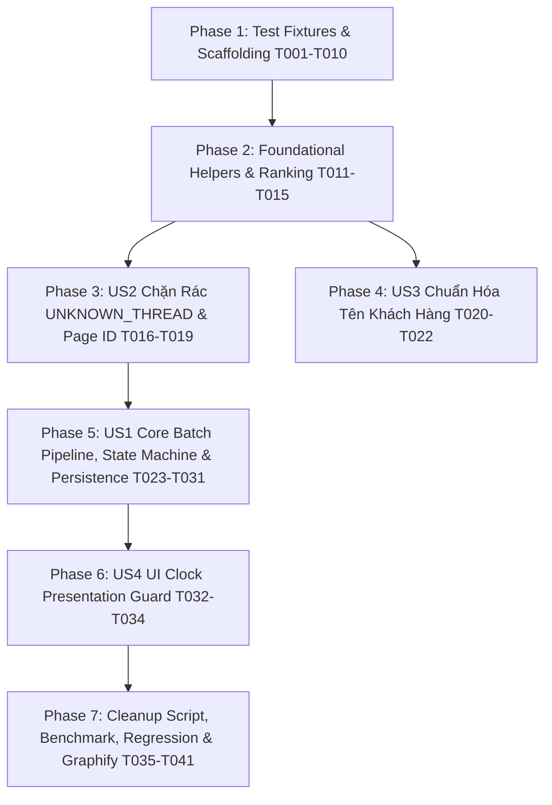

# Tasks: Chuẩn Hóa Thứ Tự Tin Nhắn Fanpage, Phân Tách Thời Gian Hiển Thị & Chặn Rác Toàn Diện (V4 - Hardened)

**Input**: Thiết kế kiến trúc từ `specs/054-page-message-chronology-and-noise-guard/` (`spec.md`, `plan.md`, `research.md`, `data-model.md`, `contracts/batch-envelope.contract.json`, `quickstart.md`)

**Prerequisites**: `plan.md`, `spec.md`, `data-model.md`, `contracts/batch-envelope.contract.json`

**Constitution Status**: Not configured (bản mẫu template chưa ratify riêng; tuân thủ nghiêm ngặt `PROJECT_RULES.md`).

**Organization**: Các nhiệm vụ được tổ chức theo User Story (US1 - US4) và tuân thủ chặt chẽ nguyên tắc **Test-First (TDD)**: Test assertions và fixtures được viết trước khi viết code triển khai.

## Format: `- [ ] [TaskID] [P?] [Story?] Description with file path`
- **[P]**: Có thể chạy song song (khác tập tin, không phụ thuộc task chưa xong).
- **[Story]**: Gắn nhãn User Story (`[US1]`, `[US2]`, `[US3]`, `[US4]`).

---

## Phase 1: Setup & Test Scaffolding (Khởi Tạo & Bộ Khung Kiểm Thử TDD)

**Mục đích**: Chuẩn bị đầy đủ các test fixtures, contract validation và assertions trước khi can thiệp vào mã nguồn sản phẩm.

- [x] T001 [P] Tạo bộ test fixtures và assertions cho parser thời gian Page (`data-utime`, `<time datetime>`, `aria-label`, separator + clock tiếng Việt/Anh, qua nửa đêm) trong `tests/unit/page_timestamp_parser.test.js`
- [x] T002 [P] Tạo assertions cho hàm xếp hạng timestamp `getTimestampRank(source)` (Rank 1..6, nâng cấp không đổi `created_at` và `sequence_order`) trong `tests/unit/page_timestamp_ranking.test.js`
- [x] T003 [P] Tạo assertions cho chuỗi resolve Page ID trong iframe (URL frame, tab mapping, `inbox_sources`) và ownership verification trong `tests/unit/page_id_resolver.test.js`
- [x] T004 [P] Tạo assertions cho chặn rác `UNKNOWN_THREAD`, sentinel và bộ lọc tên lặp `cleanContactName()` trong `tests/unit/noise_and_sentinel_guard.test.js`
- [x] T005 [P] Tạo assertions cho ghép neo, xác thực `boundary_evidence` khớp DB, từ chối batch mơ hồ và chống gộp 2 tin "alo" trong `tests/unit/page_history_reconciliation.test.js`
- [x] T006 [P] Tạo assertions cho máy trạng thái quét (chỉ chuyển READY khi có ACK committed/duplicate khớp `{ session_epoch, generation, scan_id }`, timeout 10s retry, buffer limit 100 tin/30s overflow fallback) trong `tests/unit/thread_scan_state_machine.test.js`
- [x] T007 [P] Tạo assertions cho module hiển thị giờ `messageTimestampPresentation.js` (không fallback `created_at`, ẩn giờ khi không rõ) trong `tests/unit/ui_timestamp_presentation.test.js`
- [x] T008 [P] Tạo khung integration test cho script cleanup (`--dry-run`, `--apply`, snapshot backup WAL, `sync_status = 'NEEDS_RESYNC'`) trong `tests/integration/cleanup_page_garbage.test.js`
- [x] T009 [P] Tạo khung integration test cho pipeline Page batch, ACK, stale generation, và kiểm tra hồi quy Messenger cá nhân trong `tests/integration/page_batch_sync_pipeline.test.js`
- [x] T010 [P] Tạo script benchmark đo toàn diện: transaction + renumber + socket broadcast trên 10.000 records với warm-up và p95 latency trong `scripts/benchmark_sequence_renumber.js`

---

## Phase 2: Foundational (Hạ Tầng Dùng Chung, Parser Extension UMD & Bộ Lọc Chuẩn)

**Mục đích**: Các helper thuần túy và giao thức nền tảng bắt buộc phải có trước khi tích hợp vào Extension và Server.

- [x] T011 Triển khai helper parser thời gian Page tương thích browser/extension UMD tại `src/extension/pageTimestampParser.js` và export CommonJS cho Node test runner đáp ứng `tests/unit/page_timestamp_parser.test.js`
- [x] T012 Triển khai hàm xếp hạng timestamp duy nhất `getTimestampRank(source)` và ma trận nâng cấp trong `src/server/repositories/ConversationRepository.js` đáp ứng `tests/unit/page_timestamp_ranking.test.js`
- [x] T013 Thêm bộ nhớ đệm TTL Cache chống trùng lặp `scan_id` (idempotency cache) và tracking `{ session_epoch, generation }` tại `src/server/repositories/ConversationRepository.js`
- [x] T014 Cập nhật bộ lọc tên dùng chung `cleanContactName()` và `isInvalidContactName()` với regex chặn chuỗi lặp `/(?:Tất cả tin nhắn\s*){2,}/i` và `/(?:All messages\s*){2,}/i` đồng bộ ở cả `src/extension/textFilter.js` và `src/server/utils/textFilter.js`
- [x] T015 Triển khai helper thuần hiển thị giờ `src/client/utils/messageTimestampPresentation.js` (xử lý logic không fallback `created_at`, ẩn giờ hoặc hiển thị "Không rõ thời gian") đáp ứng `tests/unit/ui_timestamp_presentation.test.js`

---

## Phase 3: User Story 2 (P1) - Loại Bỏ Hoàn Toàn Thread Rác và Nội Dung Giao Diện Facebook

**Mục tiêu**: Chặn triệt để `UNKNOWN_THREAD` và nội dung menu giao diện Meta Business Suite ngay từ gốc; xác minh quyền sở hữu Page/Account.
**Tiêu chí kiểm thử độc lập**: Chạy `node --test tests/unit/noise_and_sentinel_guard.test.js` và `node --test tests/unit/page_id_resolver.test.js` PASS 100%.

- [x] T016 [US2] Cập nhật `resolveCurrentThreadId()` trả về `null` thay vì `UNKNOWN_THREAD` khi không xác định được thread trong `src/extension/page_content.js`
- [x] T017 [US2] Triển khai chuỗi resolve Page ID đa tầng cho iframe:
  - `page_content.js`: lấy URL frame con hoặc gửi message `RESOLVE_PAGE_CONTEXT` tới background.
  - `background.js`: phối hợp tab mapping/top-frame URL và gửi truy vấn tới backend nếu chưa rõ.
  - `server.js`: endpoint/helper xác minh Page ID thuộc đúng Account sở hữu và thread ID hợp lệ qua bảng `inbox_sources`.
- [x] T018 [US2] Bổ sung logic ngắt quét an toàn khi không có thread ID và khoanh vùng selector bên trong message log container đã xác nhận trong `src/extension/page_content.js`
- [x] T019 [US2] Thêm middleware/validation từ chối dứt khoát `thread_id` thuộc blacklist (`UNKNOWN_THREAD`, `unknown_dom`, `""`) và kiểm tra quyền sở hữu account/page ở cả `src/server/server.js` và `src/server/repositories/ConversationRepository.js`

---

## Phase 4: User Story 3 (P2) - Hiển Thị Đúng Tên Khách Hàng, Không Bị Lặp Chuỗi Giao Diện

**Mục tiêu**: Loại bỏ chuỗi lặp `"Tất cả tin nhắn..."` trên giao diện CRM và phòng thủ 2 lớp từ Extension đến Backend thông qua helper dùng chung.
**Tiêu chí kiểm thử độc lập**: Chạy `node --test tests/unit/noise_and_sentinel_guard.test.js` xác nhận tên lặp bị lọc sạch.

- [x] T020 [US3] Cấu hình `manifest.json` nạp `textFilter.js` và `pageTimestampParser.js` trước `page_content.js` trong mảng `content_scripts` tại `src/extension/manifest.json`
- [x] T021 [US3] Thay thế toàn bộ logic lọc tên inline trong `src/extension/page_content.js` bằng hàm gọi trực tiếp tới helper chung `cleanContactName()` từ `textFilter.js`
- [x] T022 [US3] Bổ sung bước gọi `cleanContactName()` trước khi insert/update tên vào bảng `threads` trong `src/server/server.js`

---

## Phase 5: User Story 1 (P1) - Xem Lịch Sử Chat Fanpage Đúng Thứ Tự Thời Gian (Core Batch Pipeline)

**Mục tiêu**: Batch Envelope riêng `PAGE_THREAD_MESSAGES_SYNCED_V1`, chuẩn hóa hướng gửi an toàn (không dùng `Boolean("false")`), persistence mapping an toàn cho NOT NULL SQLite, State Machine có timeout/retry và chỉ READY khi có ACK, ghép neo và xác thực bằng chứng biên.
**Tiêu chí kiểm thử độc lập**: Chạy `node --test tests/unit/page_history_reconciliation.test.js` và `node --test tests/unit/thread_scan_state_machine.test.js` PASS 100%. Cuộn tin cũ trong Fanpage hiển thị chính xác ở trên cùng.

- [x] T023 [US1] Triển khai bộ chuẩn hóa hướng gửi tại biên Extension: kiểm tra tường minh `val === true || val === 1` $\rightarrow$ `true`; `val === false || val === 0` $\rightarrow$ `false`; nếu không xác định thì gán `is_outgoing: null`, `direction_status: 'pending'`, `direction_confidence: 'unknown'` (tuyệt đối không dùng `Boolean(val)` hay gán "high" giả) trong `src/extension/page_content.js`
- [x] T024 [US1] Cài đặt Backend persistence mapping: khi `is_outgoing: null` (pending), lưu `is_outgoing = 0` làm storage placeholder tạm thời trong SQLite (`messages.is_outgoing` có ràng buộc `NOT NULL`), giữ `direction_status = 'pending'`; thêm test assertion cho vòng đời `pending -> confirmed` trong `src/server/repositories/ConversationRepository.js`
- [x] T025 [US1] Tích hợp `pageTimestampParser.js` vào bộ trích xuất DOM của `src/extension/page_content.js`, đóng gói danh sách tin nhắn vào Batch Envelope theo JSON schema (kèm `session_epoch`, `generation`, `batch_sequence`) và gửi qua `PAGE_THREAD_MESSAGES_SYNCED_V1` (khai tử việc bắn lẻ backlog qua `NEW_PAGE_MESSAGE_FROM_DOM`)
- [x] T026 [US1] Cài đặt `ThreadScanStateMachine` trong `src/extension/page_content.js`: gom tin realtime vào `realtimeBuffer` khi `BASELINING` (giới hạn 100 tin hoặc 30s kèm chính sách overflow fallback); CHỈ chuyển `READY` khi nhận `PAGE_BATCH_ACK` khớp đúng `{ session_epoch, generation, scan_id }` có status `committed` hoặc `duplicate`; nếu timeout 10s hoặc status lỗi thì giữ buffer và retry với generation mới
- [x] T027 [US1] Tách crawler trong `background.js`: nhánh Page sync điều phối trực tiếp tới `page_content.js` qua `chrome.tabs.sendMessage` (loại bỏ hoàn toàn crawler `executeScript` thứ hai cho Page); giữ nguyên 100% crawler cho Messenger cá nhân; chuyển tiếp `PAGE_BATCH_ACK` về đúng tab/frame trong `src/extension/background.js`
- [x] T028 [US1] Cài đặt socket handler `PAGE_THREAD_MESSAGES_SYNCED_V1` trong `src/server/server.js`: kiểm tra session_epoch, stale generation, batch_sequence, xác thực `boundary_evidence` khớp trạng thái CSDL, gọi Repository và phát ngược lại `PAGE_BATCH_ACK`
- [x] T029 [US1] Cài đặt thuật toán ghép neo (anchor matching), xác thực bằng chứng biên (`boundary_evidence` bắt buộc `previous_oldest_message_id` khớp DB, cờ crawler chỉ là phụ trợ), và renumber `sequence_order` từ `1..N` tuần tự trong `src/server/repositories/ConversationRepository.js`
- [x] T030 [US1] Bảo vệ danh sách Sidebar: đảm bảo batch nạp lịch sử cũ không tăng `unread_count`, không lùi `last_activity` và không đẩy thread lên đầu sidebar trong `src/server/server.js`
- [x] T031 [US1] Bảo toàn luồng Realtime Delta: đảm bảo tin mới phát sinh sau khi `READY` tiếp tục gửi qua `NEW_PAGE_MESSAGE_FROM_DOM` để kích hoạt đầy đủ các side-effects nghiệp vụ (outbound pending, media, phone capture, UI emit) trong `src/server/server.js`

---

## Phase 6: User Story 4 (P2) - Nâng Cấp Thời Gian Hiển Thị Minh Bạch, Không Đánh Lừa Bằng `created_at`

**Mục tiêu**: UI không bao giờ hiển thị `created_at` làm giờ gửi của khách; nâng cấp timestamp từ nguồn tin cậy hơn mà không làm thay đổi `created_at` ban đầu hay `sequence_order`.
**Tiêu chí kiểm thử độc lập**: Chạy `node --test tests/unit/ui_timestamp_presentation.test.js` PASS 100%.

- [x] T032 [US4] Cập nhật `src/client/components/MessageList.jsx` sử dụng `messageTimestampPresentation.js` để gom nhóm ngày tin nhắn, loại bỏ hoàn toàn fallback `created_at`
- [x] T033 [US4] Cập nhật `src/client/components/MessageBubble.jsx` sử dụng `messageTimestampPresentation.js` để format giờ hiển thị, ẩn giờ hoặc hiển thị "Không rõ thời gian" khi `timestamp_ms <= 0`
- [x] T034 [US4] Cập nhật `src/client/components/ChatArea.jsx` sử dụng `messageTimestampPresentation.js` để phân nhóm ngày tin nhắn

---

## Phase 7: Polish, Safe Cleanup, Verification & Governance (Hoàn Thiện & Quản Trị Hệ Thống)

**Mục tiêu**: Script dọn rác an toàn trên CSDL thật, kiểm tra benchmark hiệu năng end-to-end, syntax check JS, chạy toàn bộ regression và cập nhật Knowledge Graph.

- [x] T035 Hoàn thiện script dọn rác an toàn `scripts/cleanup_page_garbage.js` với chế độ `--dry-run` mặc định, `--apply`, tạo snapshot backup tương thích SQLite WAL `data/backup_database_<timestamp>.db`, xóa `UNKNOWN_THREAD`, chuẩn hóa tên và đánh dấu `sync_status = 'NEEDS_RESYNC'`
- [x] T036 Chạy test integration cho script dọn rác trên CSDL SQLite tạm `node --test tests/integration/cleanup_page_garbage.test.js`
- [x] T037 Chạy test integration toàn diện kiểm tra pipeline Page batch, ACK, stale generation và kiểm tra hồi quy Messenger cá nhân `node --test tests/integration/page_batch_sync_pipeline.test.js`
- [x] T038 Chạy script benchmark renumber và broadcast `node scripts/benchmark_sequence_renumber.js` xác nhận thời gian p95 < 300ms trên 10.000 messages qua nhiều vòng chạy
- [x] T039 Chạy syntax validation `node --check` cho toàn bộ các tập tin JavaScript ngoài Vite (`src/extension/*.js`, `src/server/**/*.js`, `scripts/*.js`)
- [x] T040 Chạy toàn bộ test regression `npm run test:persistence` xác nhận 100% test hiện tại PASS và chạy `npm run build:ui` thành công
- [x] T041 Chạy `graphify update .` cập nhật Knowledge Graph codebase theo quy định bắt buộc trong `PROJECT_RULES.md`

---

## Dependency Graph & Implementation Order

### Parallel Opportunities Identified
- **Pha 1 (T001 - T010)**: Hoàn toàn có thể chạy song song vì là các file test unit/integration độc lập.
- **Pha 3 & Pha 4 (T016-T022)**: Có thể triển khai độc lập sau khi Phase 2 hoàn tất.
- **Pha 6 (T032 - T034)**: Các file component UI có thể cập nhật song song sau khi helper `messageTimestampPresentation.js` đã sẵn sàng.

---

## Technical MVP vs Production Release
- **Technical MVP (Phase 1 $\rightarrow$ Phase 5)**: Đủ để giải quyết triệt để lỗi đảo lộn thứ tự tin nhắn Fanpage khi cuộn lịch sử, loại bỏ hoàn toàn thread rác `UNKNOWN_THREAD`, bảo đảm hướng gửi chuẩn xác và bảo vệ an toàn 100% cho Messenger cá nhân.
- **Production Full Release (Phase 6 + Phase 7)**: Đạt độ chuẩn hóa toàn diện: UI Clock Guard hiển thị minh bạch, dọn sạch rác CSDL cũ có backup WAL, syntax validation `node --check`, nghiệm thu benchmark hiệu năng trên 10.000 records, và cập nhật Knowledge Graph qua `graphify update .`.
